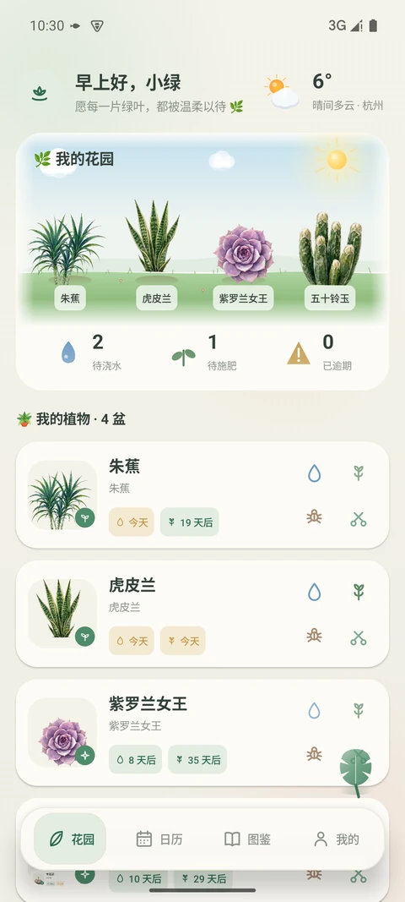
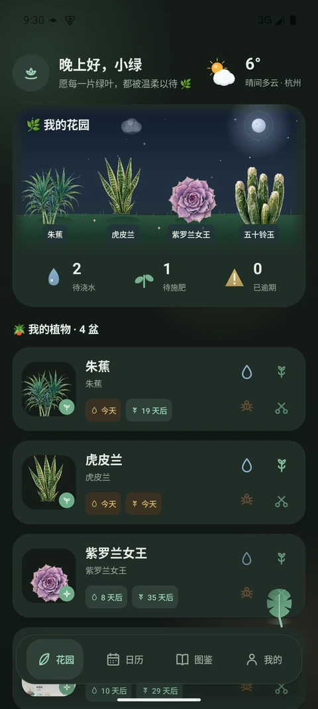
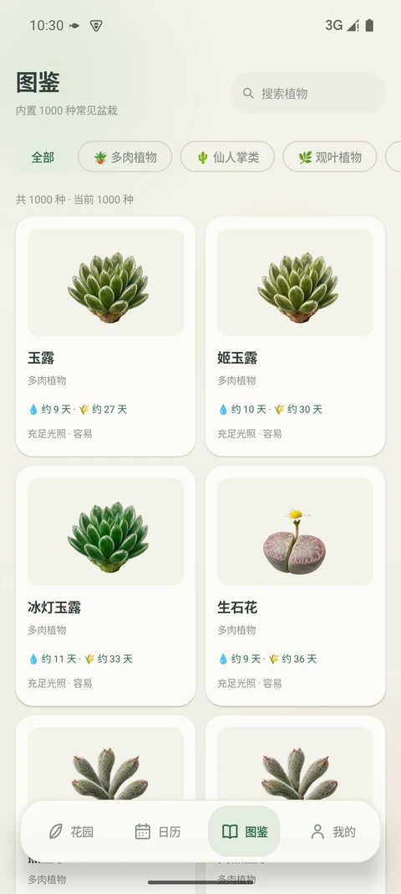
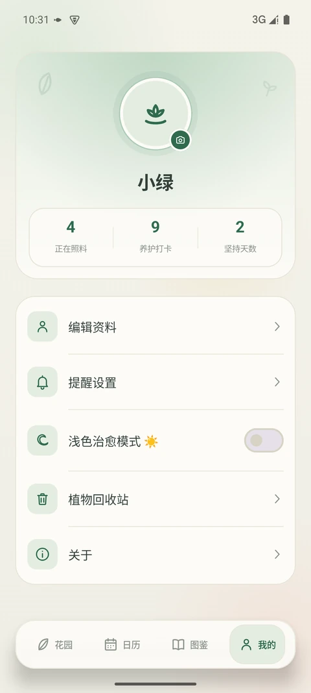

<div align="center">

# 🌿 My Garden · 我的花园

**一款离线单机的 Android 植物养护记录 App**

[](https://github.com/MarkTop1/MyGarden-MK/releases)
[](https://developer.android.com/)
[](https://kotlinlang.org/)
[](https://developer.android.com/jetpack/compose)
[](LICENSE)

[下载 APK](releases/MyGarden-v2.0.apk) · [查看发布记录](https://github.com/MarkTop1/MyGarden-MK/releases) · [提交问题](https://github.com/MarkTop1/MyGarden-MK/issues)

</div>

---

<p align="center">
  
  
  
  
</p>

<p align="center"><sub>花园 · 深夜花园 · 图鉴 · 我的</sub></p>

---

## 📱 关于本应用

**My Garden（我的花园）** 是一款帮助你打理阳台植物的离线记录工具。它把「该浇水了」「该施肥了」这类容易忘的小事，变成一眼可见的待办清单。

- **完全离线** —— 所有数据只存在你的手机本地，不联网也能用，不上传任何隐私
- **无需登录** —— 打开即用，没有账号体系
- **开箱即装** —— 内置 1000 种常见盆栽图鉴，第一次打开就能开始记录

> 📦 **当前版本：v2.0**　｜　包名 `com.codegarden.app`　｜　最低支持 Android 8.0 (API 26)

---

## ✨ 核心功能

### 🌱 我的花园（首页）

- **花园全景** —— 每盆植物都以插画形式立在草地上，风过时轻轻摇曳
- **会呼吸的天空** —— 天空配色随实时天气与昼夜切换：晴天的太阳缓缓旋转，阴天飘过云层，雨天落雨、雪天飘雪，雷雨会闪过一道电光，起雾时远景朦胧
- **昼夜与流星** —— 入夜后天空转为深蓝，星星闪烁、偶有流星划过；白天则有小鸟横掠、蝴蝶与蜜蜂在草间停留
- **待办概览** —— 今日需浇水 / 需施肥 / 已逾期，一眼看清
- **健康状态** —— 每盆植物按逾期程度分为 6 档：✨ 生机盎然 → 🌱 状态良好 → 💧 需要照料 → 🌿 叶子微垂 → 🍂 叶尖泛黄 → 🥀 枯萎了
- **到期文案** —— 「今天」「3 天后」「已逾期 2 天」，不用自己换算
- **植物档案** —— 昵称、照片、备注、种植日期、个性化浇水/施肥周期

### 📅 养护日历

- 按月查看所有养护打卡记录
- 标记有记录的日期，直观回溯你的养护节奏
- 点击任意记录可跳转到对应植物详情

### 📖 植物图鉴

- **内置 1000 种**常见盆栽，涵盖 **8 大分类**

  | 分类 | 数量 | 分类 | 数量 |
  |------|------|------|------|
  | 🪴 多肉植物 | 220 | 🌿 观叶植物 | 180 |
  | 🌵 仙人掌类 | 140 | 🌸 开花植物 | 180 |
  | 🌱 香草植物 | 90 | 🌳 盆景木本 | 90 |
  | 🌷 球根花卉 | 60 | 🪷 水生植物 | 40 |

- 635 张手绘风植物插画，随包内置、无需联网加载
- 每种植物含**参考浇水周期、施肥周期、光照需求、养护难度、栽培要点**
- 支持搜索与分类筛选
- 一键「就养这盆」—— 直接从图鉴添加到我的花园

### ✅ 养护打卡

- 四种养护动作：💧 浇水　🌾 施肥　🐛 除虫　✂️ 修剪
- 可记录**浇水量 / 施肥量**（如「200ml」「1 小勺」）与**当日照片**
- 打卡后自动重算下一次到期时间

### 🔔 养护提醒

- **每日提醒**（默认 09:00）与**逾期提醒**（默认 18:00），时间可自定义
- 使用 `AlarmManager` 精确闹钟 + 开机自启（`BOOT_COMPLETED`）恢复计划
- 通知推送当天的待养护汇总
- 自动适配系统「精确闹钟」「通知」权限状态并引导开启

### 🌦️ 天气小组件

- 基于 **Open-Meteo** 公共接口，**无需任何 API Key**
- 自动定位或手动搜索城市；支持坐标反查城市名
- 依据 WMO 天气码归类为 ☀️ 晴 / ⛅ 晴间多云 / ☁️ 阴 / 🌫️ 有雾 / 🌦️ 毛毛雨 / 🌧️ 有雨 / ❄️ 有雪 / ⛈️ 雷阵雨，并驱动花园天空与天气动效
- 网络失败自动降级，不影响主流程

### 🗑️ 回收站

- 删除的植物进入回收站，**保留 30 天**可随时恢复
- 植物资料与养护记录一并保留
- 倒计时展示剩余保留天数，到期自动彻底清除

### 👤 我的

- 昵称与头像设置
- 深色模式开关（深夜森林）
- 提醒时间、天气城市等偏好设置
- 回收站入口

---

## 🛠 技术栈

| 类别 | 选型 |
|------|------|
| 语言 | Kotlin 2.0.21 |
| UI | Jetpack Compose（Material 3） |
| 架构 | 单 Activity + Navigation Compose + ViewModel |
| 状态管理 | `StateFlow` + `collectAsStateWithLifecycle` |
| 场景动效 | Compose `Canvas` 自绘 + `InfiniteTransition`（天空、天气粒子、植物摇曳、飞鸟虫蝶） |
| 本地存储 | JSON 序列化 + FileProvider 私有目录存图 |
| 后台任务 | AlarmManager 精确闹钟 + BroadcastReceiver |
| 天气数据 | Open-Meteo / bigdatacloud（公开接口，免密钥） |
| 构建 | Gradle 8.9 · AGP 8.7.3 · Kotlin DSL |
| 依赖仓库 | 阿里云镜像（`maven.aliyun.com`），失败自动回退官方源 |

**第三方库**：`dev.chrisbanes.haze:haze`（毛玻璃模糊效果）—— 底部导航与页面切换的磨砂质感。

---

## 📂 项目结构

```
CodeGarden/
├── app/
│   ├── build.gradle.kts          # 应用模块构建脚本（含可选签名配置）
│   ├── proguard-rules.pro
│   └── src/main/
│       ├── AndroidManifest.xml
│       ├── assets/
│       │   ├── plants.json           # 1000 种植物图鉴数据
│       │   ├── plant_images_map.json # 物种 → 图片映射
│       │   └── plant_images/         # 635 张 WebP 植物插画
│       ├── java/com/codegarden/app/
│       │   ├── MainActivity.kt
│       │   ├── data/
│       │   │   ├── CareEngine.kt        # 养护推算引擎（纯函数）
│       │   │   ├── PlantCatalog.kt      # 图鉴加载
│       │   │   ├── PlantRepository.kt   # 我的植物仓库
│       │   │   ├── local/               # 本地存储 & 照片存储
│       │   │   ├── model/Models.kt      # 数据模型
│       │   │   └── weather/             # 天气数据源
│       │   ├── notify/Reminders.kt      # 闹钟 & 通知
│       │   ├── ui/
│       │   │   ├── AppNavGraph.kt       # 导航图
│       │   │   ├── components/          # 通用组件（含花园场景 GardenShowcase）
│       │   │   ├── screens/             # 各功能页面
│       │   │   └── theme/               # 主题与配色
│       │   └── viewmodel/MainViewModel.kt
│       └── res/                         # 资源文件
├── docs/screenshots/              # README 展示图
├── releases/
│   └── MyGarden-v2.0.apk          # 可直接安装的发布包
├── build.gradle.kts
├── settings.gradle.kts
└── gradle.properties
```

---

## 🛠 从源码构建

### 环境要求

- Android Studio Koala 或更高版本 / **JDK 17+**
- Android SDK **API 34**（compileSdk / targetSdk 均为 34）

### 构建命令

```bash
git clone https://github.com/MarkTop1/MyGarden-MK.git
cd MyGarden-MK

# Debug 包（无需任何签名配置）
./gradlew assembleDebug

# Release 包（未配置签名时产出 unsigned APK）
./gradlew assembleRelease
```

### 配置发布签名（可选）

仓库**不包含**任何签名密钥。如需生成可正式分发的 Release 包：

1. 生成 keystore（**请自行保管，切勿提交到 Git**）：

   ```bash
   keytool -genkeypair -v \
     -keystore codegarden-release.jks \
     -alias codegarden \
     -keyalg RSA -keysize 2048 -validity 10950
   ```

2. 在项目根目录创建 `keystore.properties`：

   ```properties
   storeFile=../keystore/codegarden-release.jks
   storePassword=你的密钥库密码
   keyAlias=codegarden
   keyPassword=你的密钥密码
   ```

3. 重新构建：

   ```bash
   ./gradlew assembleRelease
   ```

> `keystore.properties` 与 `*.jks` 已被 `.gitignore` 排除，**不会**被提交到仓库。
> 若未提供 `keystore.properties`，构建会自动跳过签名并产出 unsigned APK，不影响任何人克隆后正常编译。

---

## 📝 更新日志

### v2.0

- **全新花园场景**：首页植物改为插画立在草地上，随时间推移轻轻摇曳
- **天空随天气变化**：晴 / 阴 / 雾 / 雨 / 雪 / 雷阵雨 各有独立配色与粒子效果
- **昼夜系统**：夜间转深蓝星空，星星闪烁、流星划过；白天有飞鸟、蝴蝶与蜜蜂
- **图鉴扩充至 1000 种**，插画增至 635 张，补齐水生、球根、香草等分类
- 新增「深夜森林」深色模式，夜间浏览更护眼

### v1.0

- 首个公开版本：花园首页、养护日历、植物图鉴、打卡、提醒、回收站

---

## 📄 开源协议

[MIT License](LICENSE)

---

## 🌱 说明

本项目为个人独立开发的开源作品。植物图鉴数据与图片仅供个人养护记录参考使用，具体养护请以实际植物习性为准。
